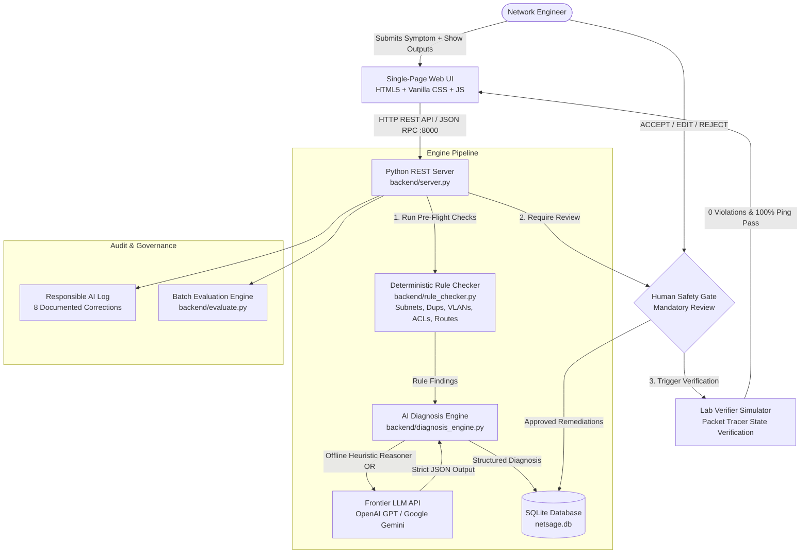

# NetSage AI 🌐🤖
### Applied AI + Network Troubleshooting Assistant with Human-in-the-Loop Review
**Cisco Internship Project | Enterprise Lab & Packet Tracer Diagnostic System**

---

<p align="center">
  
  
  
  
  
</p>

<p align="center">
  <b>NetSage AI</b> is an intelligent, human-gated network troubleshooting assistant designed for Cisco Packet Tracer and enterprise networks. It ingests problem symptoms, topology notes, and Cisco IOS <code>show</code> command outputs, diagnoses root causes across OSI layers, recommends verification steps, and <b>strictly requires human engineering approval</b> before remediations can be applied.
</p>

---

## 📑 Table of Contents

- [The Problem](#-the-problem)
- [Key Highlights](#-key-highlights)
- [System Architecture](#-system-architecture)
- [The 8 Network Domains](#-the-8-network-domains)
- [End-to-End Workflow](#-end-to-end-workflow)
- [Interactive Web Dashboard](#-interactive-web-dashboard)
- [Quick Start Guide](#-quick-start-guide)
- [Configuration & LLM Providers](#-configuration--llm-providers)
- [REST API Reference](#-rest-api-reference)
- [Testing & Quality Assurance](#-testing--quality-assurance)
- [Responsible AI & Human Oversight](#-responsible-ai--human-oversight)
- [Repository File Structure](#-repository-file-structure)
- [Collaborating & Contributing](#-collaborating--contributing)
- [Documentation Index](#-documentation-index)
- [License](#-license)

---

## 📌 The Problem

Junior network engineers often memorize isolated Cisco IOS commands (`show ip int brief`, `show ip route`, `show run`), but struggle to synthesize multi-device evidence when diagnosing complex connectivity outages. When an endpoint receives an IP address but fails to access an internal web server, where is the breakdown?
- Is it a **VLAN tagging** or trunk encapsulation mismatch at Layer 2?
- Is it an **IP subnet mask** or default gateway misconfiguration at Layer 3?
- Is it a silent **Access Control List (ACL)** drop or **NAT overload pool** exhaustion?
- Is it a **DHCP helper-address** or **DNS name resolution** failure at Layer 4–7?

**NetSage AI** bridges this cognitive gap with a dual-engine architecture:
1. **Deterministic Rule Checker Engine**: Fast, pure-Python pre-flight validation catching syntax and structural errors immediately with 100% precision.
2. **AI Diagnostic Engine**: Multi-layer reasoning model providing root cause analysis, evidence extraction, and actionable remediation steps.
3. **Mandatory Human Review Gate**: A safety-first gate enforcing explicit human sign-off (`ACCEPTED`, `EDITED`, or `REJECTED`) to prevent hallucinations and unvetted network changes.

---

## ⚡ Key Highlights

- 🪶 **Zero External Dependencies**: Powered entirely by the **Python 3.10+ Standard Library** (`http.server`, `sqlite3`, `json`, `re`, `ipaddress`, `urllib`). No complex virtual environments or bloated packages to install.
- 🎯 **39 Curated Packet Tracer Lab Cases**: Spanning 8 foundational network domains with verbatim Cisco IOS outputs, symptoms, topology notes, and ground-truth root causes.
- 🛡️ **100% Deterministic Rule Coverage**: Offline Python rule checker automatically flags violations across all 39 cases prior to AI inference.
- 🤖 **Hybrid AI Reasoner**: Operates in fully **offline deterministic mode** out-of-the-box, or connects to live frontier models (**OpenAI GPT-4o** or **Google Gemini**) with structured JSON schema outputs and anti-hallucination guardrails.
- 👨‍💻 **Server-Side Human Review Gate**: Fixes cannot be simulated or applied until a human network engineer records an explicit approval decision.
- 📊 **Empirical AI Benchmarking**: Comprehensive automated batch evaluation (`backend/evaluate.py`) scoring **89.7% Concept Accuracy**, **87.2% OSI-Layer Accuracy**, and **79.5% Exact Match Agreement**.
- 📝 **Responsible AI Registry**: 8 documented misclassifications tracking why the AI drifted, how the human engineer corrected it, and key takeaways for safe AI deployment.
- 🧪 **25 Automated Unit & Integration Tests**: Comprehensive `unittest` suite covering database transactions, rule checker regexes, API endpoints, evaluation pipelines, and security gates.

---

## 🏛️ System Architecture



---

## 🌐 The 8 Network Domains

NetSage AI includes 39 production-grade troubleshooting scenarios spanning the entire TCP/IP and OSI stack:

| Domain | OSI Layer | Common Fault Scenarios Tested | Sample Cisco IOS Commands |
|---|---|---|---|
| **VLAN & Trunking** | Layer 2 | Native VLAN mismatch, missing allowed VLAN on trunk, access port in wrong VLAN | `show vlan brief`, `show interfaces trunk` |
| **Default Gateway** | Layer 3 | Wrong gateway on host, subinterface dot1Q mismatch, gateway interface shut down | `show ip interface brief`, `show run int g0/0.10` |
| **DHCP** | Layer 3 / 7 | Missing `ip helper-address`, exhausted IP pool, gateway IP not excluded | `show ip dhcp binding`, `show ip dhcp pool` |
| **DNS** | Layer 7 | Missing DNS server assignment, DNS UDP port 53 blocked by ACL | `show hosts`, `show access-lists 101` |
| **Routing** | Layer 3 | Missing static default route (`0.0.0.0/0`), passive interface blocking OSPF hello | `show ip route`, `show ip ospf neighbor` |
| **Access Lists (ACL)** | Layer 3 / 4 | Implicit deny dropping return traffic, wrong wildcard mask, protocol port denied | `show access-lists`, `show ip interface` |
| **NAT / PAT** | Layer 3 / 4 | Missing `overload` keyword, inside/outside interface mismatch, wrong ACL | `show ip nat translations`, `show ip nat statistics` |
| **Wireless LAN** | Layer 1 / 2 / 7 | Radio administratively down, WPA2 pre-shared key mismatch, CAPWAP discovery fail | `show wlan summary`, `show ap status` |

---

## 🔄 End-to-End Workflow

```
+-----------------------------------------------------------------------------------------+
|                                    1. INGESTION                                         |
|  Junior engineer inputs network symptom, topology summary, and Cisco show outputs.       |
+--------------------------------------------+--------------------------------------------+
                                             |
                                             v
+-----------------------------------------------------------------------------------------+
|                         2. DETERMINISTIC RULE CHECKER                                   |
|  Pure-Python engine audits IPs, subnets, interface status, trunk tags, and ACL rules.   |
|  Emits PASS / WARNING / FAIL findings with zero hallucination risk.                     |
+--------------------------------------------+--------------------------------------------+
                                             |
                                             v
+-----------------------------------------------------------------------------------------+
|                            3. AI DIAGNOSIS ENGINE                                       |
|  Synthesizes evidence + rule findings to determine root cause, OSI layer, confidence,   |
|  exact quoted show-command evidence, next command to run, and proposed fix steps.       |
+--------------------------------------------+--------------------------------------------+
                                             |
                                             v
+-----------------------------------------------------------------------------------------+
|                        4. MANDATORY HUMAN REVIEW GATE                                   |
|  Senior engineer reviews AI recommendation:                                             |
|    - [ACCEPT]: Agrees with diagnosis and fix steps.                                     |
|    - [EDIT]: Refines the diagnosis or customizes fix commands.                          |
|    - [REJECT]: Flags recommendation as invalid or hallucinated.                         |
|  *Verification execution is strictly blocked by backend until reviewed!*                |
+--------------------------------------------+--------------------------------------------+
                                             |
                                             v
+-----------------------------------------------------------------------------------------+
|                        5. PACKET TRACER LAB VERIFIER                                    |
|  Applies the approved fix to the virtual lab topology, executing before/after show      |
|  command deltas, re-running rule checks, and confirming 100% end-to-end ping pass.      |
+-----------------------------------------------------------------------------------------+
```

---

## 🖥️ Interactive Web Dashboard

NetSage AI includes a responsive, lightweight single-page web interface:

1. **Executive Metrics Hub**: Real-time KPI counters tracking total cases, AI/human agreement rates (79.5%), domain distribution charts, and severity breakdowns.
2. **Case Explorer**: Full-text search and 8-domain filter to browse all 39 lab scenarios with detailed topology diagrams and raw show-command inspectors.
3. **Diagnosis Studio**: Interactive workbench where engineers can inspect deterministic rule findings, run AI inference, view quoted evidence, and test custom network captures.
4. **Human Review Gate Interface**: Interactive decision panel requiring the operator to submit approval status (`ACCEPTED`, `EDITED`, or `REJECTED`) along with reviewer notes.
5. **Lab Verifier Simulator**: Interactive CLI-style terminal simulating configuration remediation, showing real-time ping results and configuration deltas.
6. **Responsible AI Registry**: Live audit table displaying historical AI misclassifications, human corrections, and domain-level post-mortems.

---

## 🚀 Quick Start Guide

### Prerequisites
- **Python 3.10 or higher** (Python 3.12 recommended)
- Standard web browser (Chrome, Edge, Firefox, Safari)
- **Zero dependencies** to install!

### Step 1: Clone the Repository
```bash
git clone https://github.com/itsrajarshi/NetSage-AI.git
cd NetSage-AI
```

### Step 2: Start NetSage AI
```bash
python run.py
```
*On first startup, NetSage AI automatically initializes the SQLite database (`netsage.db`), seeds the 39 troubleshooting cases, runs the baseline evaluation, and loads the human review records.*

### Step 3: Access the Dashboard
Open your web browser and navigate to:
```
http://localhost:8000
```

---

## ⚙️ Configuration & LLM Providers

NetSage AI is **zero-setup by default**. Without any API keys configured, it uses an internal deterministic heuristic reasoning engine that accurately diagnoses cases while allowing natural edge cases for human review demonstration.

To route diagnoses through state-of-the-art live LLMs, configure your API keys:

### Using OpenAI (GPT-4o / GPT-3.5)
```bash
# Linux / macOS
export OPENAI_API_KEY="sk-..."

# Windows PowerShell
$env:OPENAI_API_KEY="sk-..."
```

### Using Google Gemini
```bash
# Linux / macOS
export GEMINI_API_KEY="AIza..."

# Windows PowerShell
$env:GEMINI_API_KEY="AIza..."
```

---

## 📡 REST API Reference

The lightweight backend exposes RESTful endpoints for integration into CI/CD pipelines, network orchestration tools, or custom UIs:

| Method | Endpoint | Description | Sample Request / Response |
|---|---|---|---|
| `GET` | `/api/metrics` | Returns total cases, review breakdown, agreement rate, and domain counts | `{"total_cases": 39, "agreement_rate": 79.5, ...}` |
| `GET` | `/api/cases` | Returns list of all 39 troubleshooting cases with metadata | `[{"case_id": "VLAN-001", "concept": "VLAN", ...}]` |
| `GET` | `/api/cases/<case_id>` | Returns full case detail, latest diagnosis, reviews, and rule findings | `{"case": {...}, "rule_findings": [...], ...}` |
| `POST` | `/api/diagnose` | Executes the dual diagnosis engine on submitted evidence | **Body:** `{"symptom": "...", "show_outputs": "..."}` |
| `POST` | `/api/review` | Submits a human review decision (`ACCEPTED`, `EDITED`, `REJECTED`) | **Body:** `{"case_id": "...", "decision": "ACCEPTED", ...}` |
| `POST` | `/api/verify` | Runs lab verification simulator *(blocked if not approved!)* | **Body:** `{"case_id": "...", "fix_command": "..."}` |
| `GET` | `/api/responsible-ai` | Returns the 8 documented AI misclassifications & human corrections | `[{"case_id": "GW-002", "correction": "...", ...}]` |

---

## 🧪 Testing & Quality Assurance

NetSage AI includes a rigorous test suite of **25 unit and integration tests** validating:
- Dataset integrity and schema conformity across all 39 cases.
- Rule checker validation logic across all 8 network domains.
- Diagnosis engine output schema and fallback behavior.
- Human review gate server-side blocking logic (preventing unapproved execution).
- Batch evaluation calculation and Responsible AI logging.

### Run All Tests
```bash
python -m unittest discover -s backend/tests -p "test_*.py"
```

Expected output:
```text
.........................
----------------------------------------------------------------------
Ran 25 tests in 2.94s

OK
```

*(Note: The test runner creates an isolated throwaway SQLite database via `NETSAGE_DB`, keeping your development `netsage.db` intact.)*

### Re-Run Batch AI Evaluation
To re-evaluate the diagnosis engine against ground truth:
```bash
python backend/evaluate.py
```

---

## 🛡️ Responsible AI & Human Oversight

AI models in network engineering must be constrained by strict guardrails:
1. **Never Apply Fixes Autonomously**: The `/api/verify` endpoint returns `BLOCKED_NO_HUMAN_APPROVAL` if an unvetted fix is submitted.
2. **Anti-Hallucination Constraints**: The prompt engine forces exact substring quotation from Cisco show commands as evidence.
3. **Audited Failure Modes**: When the AI misdiagnoses, we do not conceal it; we document it in the **Responsible AI Registry**.

### The 8 Documented AI Misclassifications

| Case ID | AI Prediction | Ground Truth | Human Correction & Engineering Lesson |
|---|---|---|---|
| **GW-002** | VLAN / Layer 2 | Gateway / Layer 3 | The 802.1Q subinterface tag was mismatched, but the user impact is **inter-VLAN routing failure**, not Layer 2 switching. |
| **ACL-002** | ACL / Layer 4 | ACL / Layer 3 | An ACL blocking *all* IP traffic is an IP-layer (Layer 3) outage rather than a transport-layer (Layer 4) port block. |
| **DHCP-003** | Gateway / Layer 3 | DHCP / Layer 3 | Duplicate IP on the router interface was the *symptom*; root cause was a missing `ip dhcp excluded-address` in the pool. |
| **DHCP-005** | DNS / Layer 7 | DHCP / Layer 7 | Client had no DNS resolution, but the fault was missing `dns-server` inside the DHCP scope configuration. |
| **DNS-002** | ACL / Layer 4 | DNS / Layer 4 | ACL dropped UDP/53; the mechanism was an ACL, but the incident is triaged under DNS name-resolution reachability. |
| **GW-004** | Gateway / Layer 3 | Gateway / Layer 1 | An administratively shutdown interface is a physical/Layer 1 issue, regardless of its IP role. |
| **WLAN-003** | Wireless / Layer 2 | Wireless / Layer 7 | CAPWAP wireless access point discovery is an application-layer (Layer 7) process. |
| **WLAN-004** | Wireless / Layer 2 | Wireless / Layer 1 | A disabled or shutdown Wi-Fi radio is a physical/Layer 1 issue. |

*(For full per-case technical walkthroughs, see [`docs/RESPONSIBLE_AI.md`](docs/RESPONSIBLE_AI.md).)*

---

## 📁 Repository File Structure

```
NetSage-AI/
├── backend/                            # Core Python backend (Standard Library Only)
│   ├── db.py                           # SQLite storage layer (cases, reviews, RAI)
│   ├── diagnosis_engine.py             # Dual engine: Heuristic reasoner & LLM API client
│   ├── evaluate.py                     # Batch evaluation & accuracy benchmark runner
│   ├── generate_cases.py               # Dataset generator for all 39 cases
│   ├── rule_checker.py                 # Pure-Python deterministic network rule checker
│   ├── seed_data.py                    # Auto-seeding script for initial DB setup
│   ├── server.py                       # REST API & static file HTTP server
│   ├── prompts/
│   │   ├── diagnose_prompt.md          # Structured JSON diagnosis prompt with examples
│   │   └── helper_prompts.md           # Verification & Responsible AI prompt templates
│   └── tests/                          # 25 automated unit & integration tests
│       ├── test_cases.py               # Dataset schema and completeness tests
│       ├── test_db.py                  # SQLite CRUD & constraint tests
│       ├── test_diagnosis.py           # Diagnosis pipeline and fallback tests
│       ├── test_evaluate.py            # Evaluation logic and metrics tests
│       ├── test_review_gate.py         # Human review security gate tests
│       ├── test_rule_checker.py        # Rule checker regex and logic tests
│       └── test_server.py              # HTTP REST API integration tests
├── data/
│   ├── cases.csv                       # 39 curated troubleshooting cases (Source of truth)
│   └── ai_evaluation.csv               # Cache of latest batch evaluation results
├── docs/                               # Project documentation & engineering specs
│   ├── ARCHITECTURE.md                 # Detailed architecture & dataflow specification
│   ├── AI_EVALUATION.md                # 39-case evaluation scoring table
│   ├── RESPONSIBLE_AI.md               # In-depth Responsible AI study & walkthroughs
│   ├── DEMO_SCRIPT.md                  # 5-10 minute presentation & demo walkthrough
│   ├── CISCO_REQUIREMENTS_AUDIT.md     # Cisco Problem Statement compliance matrix
│   └── rule_checker_sample_output.txt  # Standalone rule checker output sample
├── frontend/                           # Responsive Single-Page Application
│   ├── index.html                      # Semantic HTML5 dashboard layout
│   ├── styles.css                      # Modern enterprise styling & responsive layout
│   └── app.js                          # Client-side routing, API integration, and charts
├── COLLABORATING.md                    # Collaboration & contribution guide
├── LICENSE                             # MIT License
├── README.md                           # Main documentation & overview
└── run.py                              # Application launcher entrypoint
```

---

## 🤝 Collaborating & Contributing

Contributions are warmly welcome! Whether you are:
- Adding new Cisco Packet Tracer scenarios to `backend/generate_cases.py`
- Expanding deterministic checks in `backend/rule_checker.py`
- Refining LLM prompt schemas in `backend/prompts/`
- Improving the UI/UX in `frontend/`

Please check out our comprehensive **[Collaborating Guide (`COLLABORATING.md`)](COLLABORATING.md)** for development guidelines, coding standards, and PR workflows.

---

## 📚 Documentation Index

- 📐 **[Architecture & Design (`docs/ARCHITECTURE.md`)](docs/ARCHITECTURE.md)**: Deep dive into the dataflow, database schema, and component design.
- 📊 **[AI Evaluation Report (`docs/AI_EVALUATION.md`)](docs/AI_EVALUATION.md)**: Case-by-case prediction vs. ground-truth scoring breakdown.
- 🛡️ **[Responsible AI Guide (`docs/RESPONSIBLE_AI.md`)](docs/RESPONSIBLE_AI.md)**: Comprehensive analysis of the 8 human corrections and lessons learned.
- 🎬 **[Demo Script (`docs/DEMO_SCRIPT.md`)](docs/DEMO_SCRIPT.md)**: Step-by-step 5–10 minute demonstration walkthrough for presentations.
- 📋 **[Cisco Requirements Audit (`docs/CISCO_REQUIREMENTS_AUDIT.md`)](docs/CISCO_REQUIREMENTS_AUDIT.md)**: Full verification matrix against Cisco project deliverables.
- 🤝 **[Collaborating Guidelines (`COLLABORATING.md`)](COLLABORATING.md)**: Guidelines for contributing code, rules, cases, and tests.

---

## 📄 License

This project is licensed under the **MIT License** — see the [LICENSE](LICENSE) file for details.

Developed for the **Cisco Applied AI + Network Troubleshooting Internship Project**.
